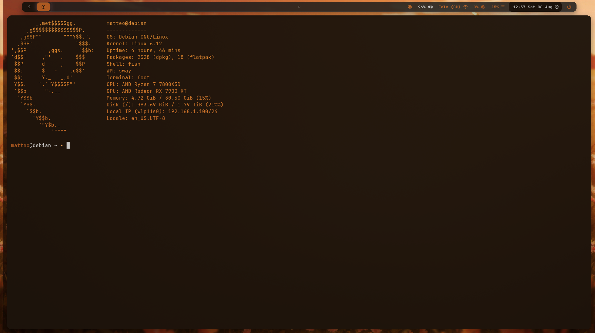
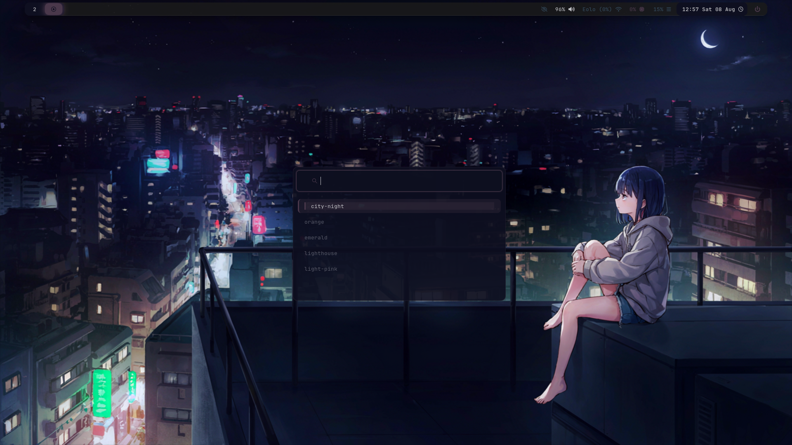
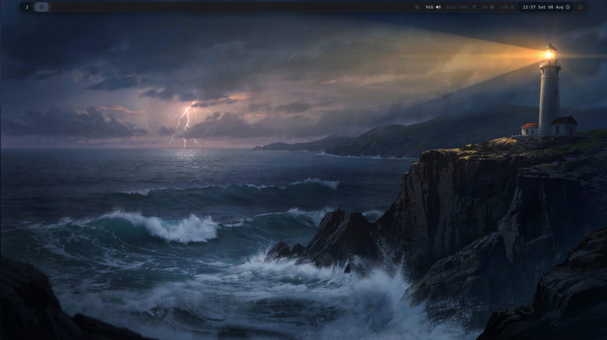

# Dotfiles

A minimal, opinionated SwayFX setup running on Debian Testing.

## Screenshots

<table>
  <tr>
    <td></td>
    <td></td>
  </tr>
  <tr>
    <td colspan="2" align="center"></td>
  </tr>
</table>

## Stack

- **WM**: [SwayFX](https://github.com/WillPower3309/swayfx) 0.5.3 (fork of Sway with blur, shadows, rounded corners)
- **Shell**: [Fish](https://fishshell.com/) with custom prompt
- **Terminal**: [Foot](https://codeberg.org/dnkl/foot)
- **Bar**: [Waybar](https://github.com/Alexays/Waybar)
- **Launcher**: [Wofi](https://github.com/emersion/wofi)
- **Notifications**: [SwayNC](https://github.com/ErikReider/SwayNotificationCenter)
- **Lock Screen**: [Swaylock](https://github.com/swaywm/swaylock)
- **Logout Dialog**: [Wlogout](https://github.com/JakeStanger/wlogout)
- **System Info**: [Fastfetch](https://github.com/fastfetch-cli/fastfetch)

## Requirements

- **OS**: Debian 13 (Trixie) — should work on any Debian-based distro with minor tweaks
- **Font**: [JetBrains Mono Nerd Font](https://www.nerdfonts.com/font-downloads) (all variants)
- **Network Manager**: `networkmanager_dmenu` (for Wi-Fi selection when clicking the network icon in Waybar)

### Install Nerd Fonts

```bash
# Download JetBrainsMono Nerd Font from https://www.nerdfonts.com/font-downloads
# Unzip and copy .ttf files to ~/.local/share/fonts/JetBrainsMono/
fc-cache -fv
```

### Install networkmanager_dmenu

```bash
sudo apt install networkmanager-dmenu
```

## Repository Structure

```
dotfiles/
├── sway/          # SwayFX, SwayNC, Swaylock, Wlogout
├── waybar/        # Status bar
├── wofi/          # Application launcher
├── foot/          # Terminal emulator
├── fish/          # Shell configuration
├── fastfetch/     # System info display
└── themes/        # Theme switcher + themes
```

See each folder's README for setup notes.

## Quick Setup

1. Copy configs to `~/.config/` (adjust paths if needed):

```bash
cp -r sway/swayfx ~/.config/sway
cp -r sway/swaync ~/.config/swaync
cp -r sway/swaylock ~/.config/swaylock
cp -r sway/wlogout ~/.config/wlogout
cp -r waybar ~/.config/waybar
cp -r wofi ~/.config/wofi
cp -r foot ~/.config/foot
cp -r fish ~/.config/fish
cp -r fastfetch ~/.config/fastfetch
```

2. Copy themes:

```bash
cp -r themes ~/.themes
```

3. Install required packages:

```bash
sudo apt install swayfx waybar wofi foot swaync swaylock wlogout fastfetch fish brightnessctl playerctl slurp grim pavucontrol networkmanager-dmenu python3 jq
```

4. Update paths in configs if your home directory or layout differs.

## Keybindings (SwayFX)

| Keybinding | Action |
|---|---|
| `Super + Return` | Open terminal |
| `Super + d` | Application launcher |
| `Super + p` | Logout dialog |
| `Super + t` | Theme switcher |
| `Super + Shift + t` | Create new theme |
| `Super + Shift + c` | Reload config |
| `Super + Shift + e` | Exit SwayFX |
| `Super + f` | Toggle fullscreen |
| `Super + j/k` | Focus left/right |
| `Super + Ctrl + j/k` | Move window left/right |
| `Super + 1-9` | Switch workspace |
| `Super + Shift + 1-9` | Move window to workspace |
| `Super + Shift + s` | Screenshot (area select) |
